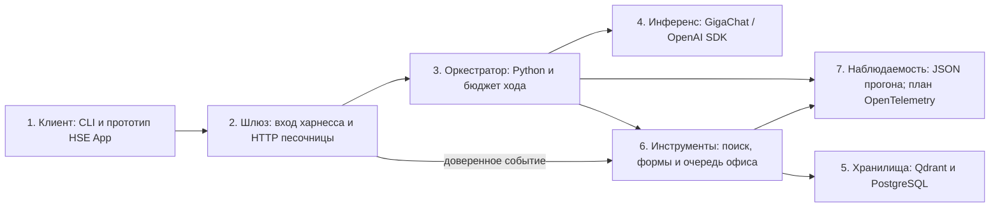

# Дизайн-док. Агент-помощник студента ФКН НИУ ВШЭ

| Поле | Значение |
|---|---|
| Этап | КТ3, общий документ КТ1–КТ3 |
| КТ1 | [Исходный контракт и бюджеты](https://github.com/aveliaev/course-rag-assistant/blob/9e19d33f419b6e0d9ae642e8bdfaa7df54e46e45/KT-1/design_doc.md) |
| КТ2 | [Контракт и замороженная методика](https://github.com/aveliaev/course-rag-assistant/blob/6c56bcbcf06f6cba296bb9674a43bf6739887cc0/KT-2/design_doc_kt2.md) |
| КТ3 | [Воспроизведение](../README.md), [ADR-001](ADR-001.md), [артефакты](../evidence/README.md) |

## 1. Контекст и пользователь

Студент ФКН хочет получить применимое учебное правило и оформить типовую заявку. Сейчас он ищет по справочнику, ПУД и страницам своей программы или задаёт вопрос учебному офису. Цена ошибки различается: неверная дата пересдачи может лишить попытки, неверное поле в заявке приводит к переоформлению, отправка за другого человека нарушает границы доступа. На защите сравниваем полезность с самостоятельным поиском и ручным заполнением формы. Экономию времени учебного офиса ещё предстоит измерить.

Пилот охватывает бакалавриат и магистратуру ФКН в Москве. КТ2 оценивал нагрузку в 2 000 обращений в обычный месяц и 9 000 в пиковый, в среднем 1,35 хода на обращение при всплеске. Контур КТ3 локальный, со 100 синтетическими профилями. Внешнее действие в вузе остаётся договорённостью с владельцем соответствующего сервиса.

## 2. Контракт

| Ситуация | Обещанное поведение | Как проверяем |
|---|---|---|
| Информационный вопрос, русский или английский текст до 2 000 символов | Ответ до 800 символов на языке обращения. Существенные факты поддерживает источник с локатором и версией, применимыми к программе и фактическому периоду | Успех хода, допустимый статус, смысл и полнота цитирования |
| Не хватает даты, потока или применимого правила | Уточнить недостающее, дать подтверждённую часть либо указать подтверждённый контакт офиса при недостатке источников | Ошибочные отказы, уместность уточнения, отсутствие догадок |
| Временный пропуск или справка об обучении | Сформировать поля, указать их происхождение и показать черновик. После кнопки владельца вернуть номер заявки в песочнице | Поля и их происхождение, отсутствие записи на первом ходе, отдельные диалоги отправки, правки и отмены |
| Случай для сотрудника | Самостоятельное обращение по контакту или подтверждаемая передача классов E1–E4, когда её принимает офис. В КТ3 карточка и подтверждение доступны через отдельный локальный шлюз с синтетической очередью | До кнопки 0 тикетов. Чужая, неверная или просроченная карточка отклоняется. Повтор возвращает тот же номер |

Классы из КТ2: **E1** — решение сотрудника по индивидуальному случаю, **E2** — подтверждённое противоречие документов, **E3** — заявка за пределом срока рассмотрения, **E4** — повторный спор с ответом. Для каждого обращения локальный шлюз сохраняет одну актуальную сводку и максимум один тикет. Общий лимит — три подтверждённых тикета на студента за последние семь дней.

Только две формы входят в каталог заявок. Согласие в тексте имеет статус реплики студента. Запись заявки и подтверждение тикета инициирует отдельное событие доверенного интерфейса. Обработка тикетов в диалоге и подключение реального учебного офиса вынесены на согласование. Пользователь получает помощь с процедурой, решение принимает сотрудник вуза.

## 3. Бюджеты и SLO

Цель КТ2 — P95 ответа или черновика до 15 с. В 444 ходах P50 составил 0,323 с, P95 — 4,196 с, максимальная задержка — 10,583 с. За 684,25 с прогон выполнил 201 генерацию и израсходовал 370 049 токенов по usage.total_tokens. Для формы генерация не используется. Для ответа по документам предел — один вызов, 2 900 входных и 250 выходных токенов. [Отчёт B0](results-rag.md)

Стоимость API в локальном замере составляет 0 ₽ в пределах квоты GigaChat-3-Ultra Freemium. Для платного сценария стоимость хода равна сумме средних тарифицируемых входных и выходных токенов, умноженных на соответствующие ставки. У Ultra отсутствует опубликованная платная ставка. Полная стоимость пилота включает инфраструктуру и труд команды. [Условия GigaChat-3-Ultra](https://developers.sber.ru/docs/ru/gigachat/models/gigachat-3-ultra)

Цели КТ2: полный успех ≥85%, смысловая корректность источников ≥95%, доступность ≥99%, P95 заявки после подтверждения ≤3 с, необоснованные отправки — 0. Для полного успеха нужна смысловая разметка, длительность подтверждения и доступность требуют отдельных замеров. 0 ₽ относится к API в квоте, а не к инфраструктуре и трудозатратам.

## 4. Архитектура

### 4.1. Семь блоков КТ3

Демонстрируемые входы — CLI харнесса и локальный HTTP-шлюз действий. SwiftUI-прототип показывается отдельно. Для расширения B1 перед ветвлением добавлен ограниченный разбор намерения моделью. Оба варианта используют одни данные, поиск, детерминированную проверку полей и шлюз заявок.

### 4.2. Два пути запроса

1. **Правило о пересдачах.** По синтетическому профилю определяем программу и область документов. Один гибридный запрос в Qdrant возвращает до 20 кандидатов. В ответ отправляется до 5 применимых выдержек. B0 получает JSON от GigaChat и разрешает метки источников, а контрольный вариант выдаёт первый фрагмент с локатором. Если источника нет, возвращается уточнение или отказ. Если модель нарушает формат, B0 возвращает выдержку как частичный ответ.
2. **Временный пропуск.** Оркестратор извлекает из реплики дату, причину и корпус, из профиля берёт данные владельца. При пропуске обязательного поля спрашивает только его. После проверки правил возвращает черновик с версией и токеном. Отдельная кнопка проверяет владельца, версию и срок, записывает заявку транзакционно и возвращает номер. Правка меняет версию, отмена закрывает карточку, повтор актуального подтверждения даёт прежний номер.

### 4.3. Компоненты и границы

B0 реализует §6.1 КТ2. Python управляет фиксированным маршрутом. Для информационного вопроса Qdrant отбирает фрагменты, GigaChat-3-Ultra формирует один ответ, код проверяет схему и источники. Для временного пропуска и справки Python распознаёт форму по правилам, собирает поля и проводит подтверждение через тестовый шлюз. Основной показатель относится к полному ходу приложения. Отдельный эксперимент с одним промптом опубликован в [results.md](results.md).

Модель ответа заменяет стартового кандидата YandexGPT из §4.4 КТ2 по решению команды. В следующие сравнения переносится та же модель. Исторические оценки стоимости Яндекса к этому API неприменимы. Снимок генератора возвращает провайдер при запросе к алиасу. В каждом результате сохраняется фактическая версия для проверки сопоставимости прогонов.

Индекс строится только из файлов реестра корпуса. SHA-256 каждого файла сверяется до обработки. Выдержки Markdown привязаны к разделам, DOCX — к пунктам, заголовкам и строкам таблиц, PDF — к страницам, XLSX — к строкам листа. Длинный текст делится на окна до 400 токенов с перекрытием 70. Локатор страницы служит ссылкой на страницу PDF. Версия в payload берётся из даты действия, академического года либо даты снимка по реестру. Гибридный поиск объединяет две выдачи по 20 записей в одной коллекции. На вход генератора поступает до пяти фрагментов. Поисковые векторы строятся локально квантованной ONNX-версией multilingual-e5-base с маскированным усреднением и нормализацией. Разреженный вектор использует BM25, нормализацию по средней длине фрагмента и IDF в Qdrant.

Область, программа, уровень, набор и редакция фильтруются до ранжирования. Для оценки по ПУД необходим фактический период изучения или ссылка, совпадающая с реестром ПУД. В 100 профилях КТ2 нет записей индивидуальных траекторий. При неоднозначности приложение запрашивает период. Даты и логика форм используют время и часовой пояс из фикстуры кейса.

Учебные правила двух форм версии `kt3-local-sandbox-v2` опираются на текст КТ2 и ранее использованный локальный контракт полей. В истории PR №2 нет файлов с оригинальными правилами песочницы, схемами форм и промптом B0, упомянутых в приложениях. Из 82 уникальных ID, перечисленных dev-кейсами, 81 разрешается в реестре официальных документов. Оставшийся ID — `sandbox_mvp_rules`. Локальная версия имеет собственный ID и хеш. Python подбирает справочный пункт по типу формы и полю, которое нужно уточнить или проверить. Ответ содержит ID, версию, текст пункта и путь к источнику. [Правила песочницы](../src/fkn_assistant/resources/form_rules.json)

Оркестратор обращается к интерфейсу ModelClient. Адаптер инкапсулирует OAuth, TLS, параметры GigaChat и вызов Chat Completions через OpenAI SDK. Pydantic-модель RagAnswer проверяет ответ, а оркестратор сверяет метки с переданным контекстом. [Архитектурное решение](ADR-001.md)

## 5. Харнесс и инструменты

Один вход для прогонов — `fkn-eval --variant ... --dataset ... --output ...`. Вариант получает вопрос, время и разрешённые атрибуты профиля. Оценщик получает эталон после возврата результата. В сохранённом замере B0 порог RRF 0,55 выбран на smoke из dev. Калибровка проверяет версию поиска и коллекции. run.json сохраняет калибровку и параметры до первого хода. На закрытый test этот скрипт не запускается.

| Операция | Выход и контракт ошибки | Таймаут и число вызовов |
|---|---|---|
| snapshot(repo, filename) | Байты фиксированного Git-объекта. Отсутствующий объект останавливает прогон до первого хода | Два чтения при запуске. Профиль на ходе читается из памяти |
| Sandbox.handle(key, profile, now, text, button, deadline, …) | Карточка, исход действия или пустой результат для информационного маршрута. Недоступная карточка получает отказ. При неопределённом исходе записи действие можно повторить с тем же ID | Одна транзакция на ход, соединение при запуске до 3 с, SQL до 2,5 с на оператор с учётом остатка |
| history(key, now, deadline) и remember(key, now, question, answer, deadline) | До пяти пар реплик и сохранение ответа. Ошибка PostgreSQL фиксируется в трассе | Одно чтение и до одного сохранения. SQL до 2,5 с с учётом остатка |
| Search.retrieve(question, profile, period, deadline) | До 20 фрагментов после RRF с локаторами и оценками. При ошибке — сообщение о недоступности, генерация пропускается | Один запрос Qdrant до 3 с с учётом остатка |
| authenticate(deadline) | Кэшированный или обновлённый OAuth-токен. Ошибка со стадией, кодом и ID запроса прерывает вызовы | До одного запроса при обновлении, до 15 с с учётом остатка |
| count_tokens(model, pieces, deadline) | Число токенов на каждый фрагмент. Ошибка API или формата останавливает генерацию | Один запрос до 3 с с учётом остатка |
| B1: interpret(text, now, deadline) | Тип запроса и дословные фрагменты полей. Фрагменты проверяются на присутствие в реплике, допустимые поля нормализуются кодом. Ошибка формата переключает на правила | Один подсчёт токенов и до одной генерации до 4 с с учётом остатка |
| HTTP-песочница: formTurn, previewStaffTicket, confirmStaffTicket | Исход формы, карточка сводки или ID тикета. Ошибки 401/403/409/422/503 с машинным кодом | Один вызов на ход, локальный HTTP таймаут 3 с на чтение и клиентское ожидание, отдельный токен доверенного клиента |
| generate(messages, options, deadline) | Текст, версия, usage, причина окончания и ID запроса. При ошибке провайдера ход прерывается. При неверном JSON или ссылке проверка переключает ответ на найденную выдержку | Один генеративный вызов, до 12 с с учётом остатка, без автоповтора |

Информационный ход B0 ограничен шестью шагами: профиль, форма, история, поиск, подготовка контекста и генерация. B1 добавляет один шаг разбора намерения, всего до семи шагов и двух генераций. `search-only` использует до шести шагов и 0 генераций. Дедлайн прекращает запуск операций после истечения 15 с. Их таймауты ограничены оставшимся временем. Коды остановки — step_limit, deadline_exceeded и context_limit. Сетевые таймауты действуют на отдельные операции ввода-вывода. Длительность завершения SQL-транзакции и локального инференса контролируем по фактической метрике хода.

У каждой карточки есть владелец, версия и краткоживущее подтверждение. Правка поля выпускает новую версию. Номер заявки создаётся только в транзакции тестового сервиса. На весь срок работы с карточкой повторная отправка с тем же ID не создаёт дубликат. Ежесуточные лимиты песочницы — 3 заявки одного вида и 10 заявок на студента. У текста пользователя нет полномочий кнопки.

[OpenAPI 3.1 песочницы](../infra/sandbox.openapi.yaml) описывает реально реализованные операции для двух форм и карточки учебного офиса. Шлюз привязывает запись к синтетическому профилю. Токен подтверждения соответствует сохранённой сводке и владельцу. Новая сводка того же обращения отзывает предыдущую карточку. Карточка проходит состояния «предложена» → «помещена в учебную очередь». Передача в реальный офис и автоматическое открытие карточки из B0/B1 требуют решений из §11. Поиск и вызовы провайдера имеют программные контракты по таблице выше.

Семь последовательностей B0 запускаются тем же обработчиком, что и одноходовой eval. Сценарии проверяют уточнение языка, уточнение корпуса, ошибку отправки и восстановление, исчерпание бюджета, изменение поля со старой карточкой, двойное подтверждение и отмену. Результат включает ответы, заданные сбои, время хода, события журнала и записи после каждого действия. [Сценарии](../src/fkn_assistant/evaluation/dialogues.py) · [Протокол прогона](../evidence/dialogues.json)

## 6. Состояние

- **Профиль.** Берётся из замороженного релиза КТ2. Имя и идентификатор для формы подставляет код. В запрос к модели входят учебные атрибуты. Перечень состояния ограничен профилем, диалогом, карточками, журналом и техническим кэшем индекса.
- **Диалог.** История информационных вопросов хранится в Postgres по среде, сессии и владельцу. Выбираются последние пять пар реплик за 30 дней. Уточнение фактического периода можно связать с вопросом о ПУД предыдущего хода. Для форм значения и их происхождение читаются непосредственно из карточки.
- **Контекст.** Общий предел входа составляет 2 900 токенов, выдержок — 2 000, генерации — 250. Размеры частей измеряются токенизатором провайдера. Под техническую разметку оставляется 80 токенов. При переполнении первыми убираются старые реплики, затем последние результаты поиска. Если доказательства не помещаются, ход заканчивается. Бюджет сохраняется в трейсе.
- **Действия.** Черновик в Postgres живёт 24 часа, подтверждение действует 15 минут, события песочницы доступны 90 дней. Истечение проверяется по часам фикстуры. Очистка просроченных записей выполняется при обращении к соответствующей среде. Журналы воспроизводимого эксперимента хранятся отдельно в каталоге прогона.
- **Между кейсами.** Каждый повтор получает отдельную сессию. Диалоги осознанно используют одну сессию на несколько ходов. Перезапуск контейнера сохраняет состояние за счёт Docker volume.

## 7. Eval-план

Из релиза КТ2 `fkn-mvp-eval-2026-10-27-v1` берём 148 dev-кейсов и 100 синтетических профилей по коммиту `6c56bcb`. Каждый первый ход запускается в отдельной сессии. Для ПУД период изучения или неоднозначность траектории проверяются отдельно, конкретные кандидаты на исправление зафиксированы [по ID](kt2-follow-up.md). Исторический `test_152.jsonl` доступен в ветке КТ2. Для КТ4 нужен независимо закрытый набор.

| Что измеряем | Где | Что значит результат |
|---|---|---|
| Статус, маршрут, JSON и поля (с источниками) | 148 dev-кейсов, в B0 три повтора | Структурный результат первого хода, отдельно пропуск и справка |
| Записи до подтверждения | Журнал каждого первого хода | До кнопки ожидаются 0 отправок. Карточка уточнения хранит рабочие поля |
| Отправку, правку, повтор, отмену, сбой и исчерпание бюджета | Семь отдельных последовательностей B0 | Исходы и фактические записи после каждого шага |
| Смысл, применимость цитаты, поля, запреты | Фиксированная выборка 50 ответов первого повтора | Все применимые критерии должны пройти. На 10 общих кейсах два человека проверяют согласие по первичным оценкам. |
| Токены, шаги, ошибки, длительность, стоимость | Метаданные и журналы вариантов | Время полного хода и расходы API с явно указанным тарифом |

 [Методика КТ2](https://github.com/aveliaev/course-rag-assistant/blob/6c56bcbcf06f6cba296bb9674a43bf6739887cc0/KT-2/design_doc_kt2.md#5-eval-план)

## 8. Baseline и усложнения

### 8.1. Измерение

| Режим общего CLI | Вариант | Статус доказательств |
|---|---|---|
| `search-only` | Контрольная точка без генеративной LLM. Тот же индекс и формы, первый фрагмент вместо синтеза. | Сохранён 148/148. [Парное сравнение первого повтора](results-search-only.md). |
| `rag-b0` | Гибридный поиск и один вызов ответа, формы на правилах. | 444/444 ходов в архиве, 148 dev × 3. |
| `rag-b1` | Модель предлагает намерение и дословные фрагменты полей. Код валидирует значения и выполняет общие операции. | Контракт, тесты и 20/20 ходов smoke с фикстурой модели. Живой dev-результат и сравнение качества ещё нужны. |
| `prompt-only` | Один промпт без поиска. | Дополнительный эксперимент, его задержка относится к API. |

Для сохранённого B0 выполнены три повтора каждого из 148 запросов. Сохраняются тексты и хеши, версии модели и индекса, параметры генерации (temperature 0,1, seed API v1 недоступен), поиск, контекст, ответ, ошибки, токены и полное время. Семь последовательностей учитываются отдельно. В отчёте разделены обе формы и качество информационных ответов. Метрики попадания документа и принадлежности ссылки выдаче вычисляются автоматически. Проверка соответствия конкретного утверждения пункту выполняется человеком по сохранённым выдержкам и эталону. [Отчёт B0](results-rag.md)

Из 444 ходов ожидаемому статусу соответствуют 208, или 46,8 %. В первом повторе среди 36 вопросов о формуле оценки совпали 4 статуса. Из 32 расхождений в 20 случаях B0 отказал до генерации после проверки порога поиска. При переходе от предыдущего замера менялись клиент, правила форм, сборка индекса и порог RRF с 0,50 на 0,55. В 55 парных ходах прежний прогон вызвал модель и совпал по статусу, а новый завершился до генерации и разошёлся по статусу. Для следующего сравнения эффект порога следует измерять отдельным экспериментом с фиксированными моделями, корпусом и промптом.

По рубрике Codex на 50 выбранных ответах прошли 19 (38%). Все 17 ответов по формам прошли в рамках реконструированных локальных правил. Среди остальных 33 прошли 2. Подтверждение содержательных утверждений прошло у 7 из 14 информационных кейсов, где этот критерий применим. Из 31 сбоя 15 пришлись на отказ ниже порога поиска, 14 — на ответы после генерации, два — на уточнение периода вне допустимых исходов эталона. Среди смысловых ошибок — устаревшие даты (E017, E045), смешение формулы оценки и предметной формулы (E221), неподтверждённые условия (E033, E217). Выборка стратифицирована с включением всех форм и не даёт оценки для всего dev. Две независимые человеческие разметки 10 общих кейсов и их согласие ещё требуются. [Оценки по ID](../evidence/b0-grades-codex.jsonl) · [Отчёт B0](results-rag.md)

Кейс E135 об общей процедуре трижды попал в маршрут справки. Оценщик одновременно отмечает ошибку маршрута и отклоняет ссылку на правило формы в информационном кейсе.

[Архив прогона и материалы ручной проверки](../evidence/README.md)

### 8.2. Усложнения

B1 добавляет разбор намерения и извлечение фрагментов, B2 запланирован для поиска по подвопросам, B3 — для реранкинга при подтверждённой проблеме ранжирования. Каждую конфигурацию сравниваем с B0 через общий харнесс по одинаковым ID, бюджету и рубрике. [Гипотезы КТ2](https://github.com/aveliaev/course-rag-assistant/blob/6c56bcbcf06f6cba296bb9674a43bf6739887cc0/KT-2/design_doc_kt2.md#62-гипотезы-и-последовательность-усложнений)

## 9. План наблюдаемости

Выбор для КТ4 — Python OpenTelemetry SDK и Langfuse по OTLP/HTTP. Это сохраняет доступ к иерархии ходов и поколениям без разработки собственного трейсера. Сейчас доказательства хранятся в JSON; экспорт и дашборд относятся к КТ4. [Документация OTLP](https://langfuse.com/docs/api-and-data-platform/features/public-api) · [Маскирование](https://langfuse.com/docs/observability/features/masking)

- Корневой `turn` получает `trace_id`. Спаны: профиль, план, форма, история, поиск, бюджет контекста, генерация, валидация, чтение и запись состояния, результат подтверждения. В каждый записываются время, исход, код ошибки и безопасные параметры. Для модели добавляются версия, хэш промпта, токены и стоимость. Для поиска — ID версий и локаторы. Для записи — тип операции и обезличенный итог карточки.
- На экспорт отправляем только поля из явного списка. ФИО, контакты, токены подтверждения, API-секреты и свободный студенческий текст остаются вне удалённого трейсинга. Для демонстрационного реплея используем отдельный локальный набор синтетических записей со сроком хранения и ограниченным доступом.
- Для реплея фиксируем хэши промптов, данных и конфигурации, синтетические часы, порядок операций и записанные ответ/ошибку каждой зависимости. Адаптеры модели, поиска и действий читают запись по `trace_id` и номеру шага; записи в песочницу заменяются фикстурой. Несовпадение шага или его аргументов останавливает реплей. Проверка — совпадение нормализованного ответа, причины остановки и последовательности действий.
- На дашборде: P50/P95 полного хода и длительности генерации, токены и расходы, ошибки инструментов, шаги, отказы и эскалации. Текущий API даёт полный ответ, поэтому фактический TTFT понадобится измерять после подключения streaming или согласовать эту метрику как неприменимую. На КТ4 разобрать три сохранённых провала и воспроизвести их по следам.

## 10. Риски и ограничения

Правила форм имеют статус учебной реконструкции. В профилях нет истории повторного прохождения дисциплин. При неоднозначности B0 уточняет фактический период. Для диагностики ПУД различаем выбор версии, покрытие корпуса и соответствие ответа источнику. Квота или недоступность API могут прервать эксперимент. Продолжение сверяет конфигурацию и учитывает сохранённые ходы.

## 11. Открытые вопросы

- Сверить правила, схемы полей и промпт с оригиналами песочницы при их получении. Если найдутся расхождения, повторить затронутые проверки.
- Завершить смысловую оценку B0 на подготовленной выборке, разобрать вопросы о ПУД и случаи недостаточности источников.
- Перед КТ4 согласовать независимый отложенный набор. Исторический test_152.jsonl доступен в ветке КТ2. В прогоне КТ3 использовался зафиксированный dev.

- Запустить B1 на том же dev с доступом к GigaChat и сравнить совпадающие первые повторы, затем остальные повторы в одинаковой конфигурации.
- Уточнить принимаемые офисом классы E1–E4 и подтвердить, достаточно ли учебной изолированной очереди на КТ3. Интеграция с реальным офисом требует отдельного разрешения владельца.

## История изменений

КТ1 закрепила пользователя, границы и цели. КТ2 заморозила методику и состав dev, описала B0 и варианты усложнения. КТ3 добавила исполняемый харнесс, измерения B0, сценарии, OpenAPI песочницы, запуск B1, отдельный поиск без генерации и предварительный смысловой аудит.
